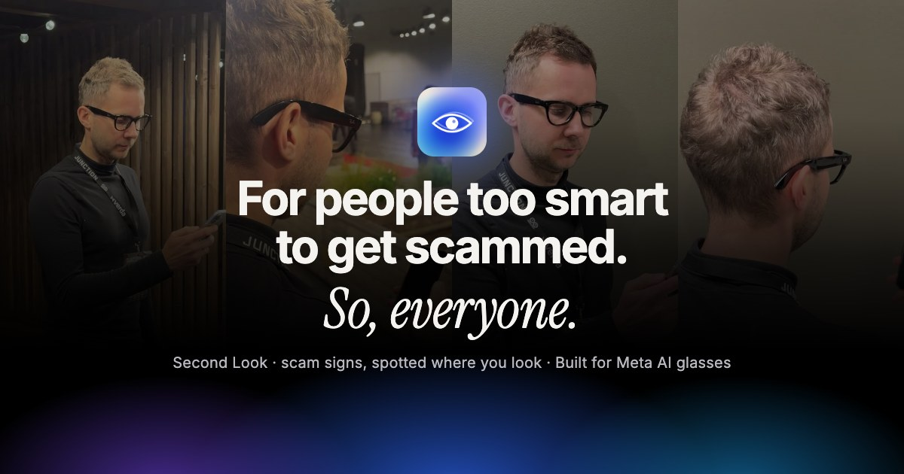
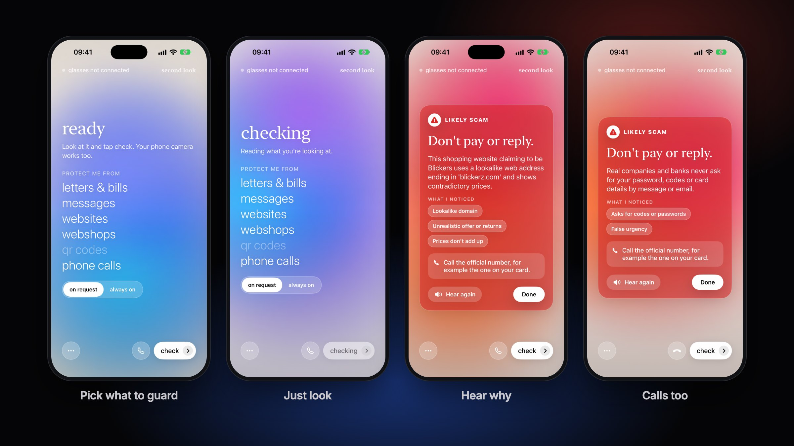
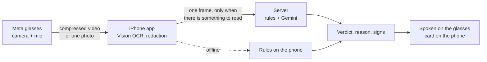
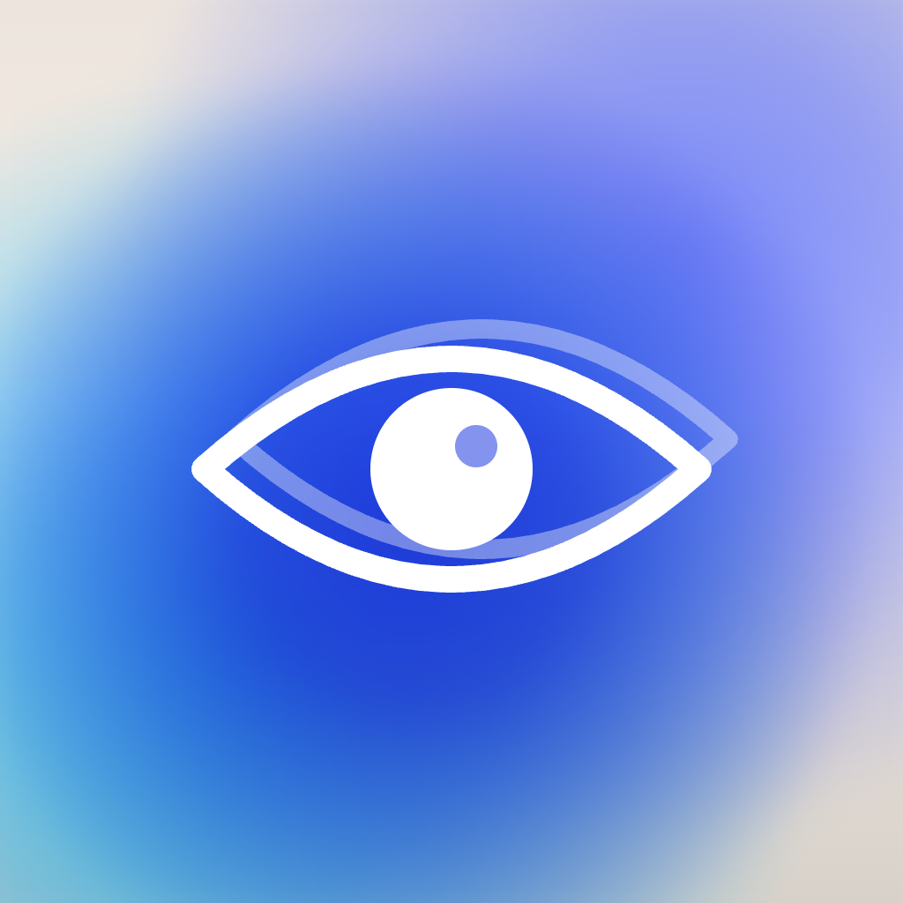

<p align="center">
  
</p>

<h1 align="center">Second Look</h1>

<p align="center">
  <b>A second opinion before you pay, through your Meta AI glasses.</b><br>
  Look at a letter, a text, a webshop or listen to a call. In about two seconds you hear whether it shows scam signs, and why.
</p>

<p align="center">
  <a href="https://youtu.be/4tVMIr4o9ec"><b>▶ Watch the video</b></a> &nbsp;·&nbsp;
  <a href="https://secondlook.pgf.lv"><b>Try it in the browser</b></a> &nbsp;·&nbsp;
  <a href="ios"><b>iOS app</b></a> &nbsp;·&nbsp;
  <a href="api"><b>Server</b></a>
</p>

<p align="center">
  
  
  
  
  
  
</p>

---

## The problem

Scams don't wait in your spam folder. They come on paper, on screens and on the phone, and they want more than a payment: a bank code, a password, your details, or remote access to your computer. Most arrive where no filter sees them.

| | |
|---|---|
| **€72.5M** | lost to scams in Finland in 2025, up from €62.9M in 2024 |
| **€38.4M** | of that taken by fake "safe account" calls |
| **57%** | of adults worldwide met a scam last year; 23% lost money |

<sub>Sources: Finance Finland (bank data), 20 Feb 2026; Global Anti-Scam Alliance, *Global State of Scams 2025*. Details in [`presentation/LEDGER.md`](presentation/LEDGER.md).</sub>

Everyone thinks they'd never fall for one. That's the point.

## What Second Look does

<p align="center">
  
</p>

- **Just look.** Tap check or press the glasses' capture button. One photo, an answer in about 2 seconds, spoken through the glasses.
- **Always on, if you want.** A quiet check every 15 seconds; it only speaks when something looks wrong.
- **It tells you why.** One verdict, what to do, one plain reason and the signs it noticed. *"Uses the name 'ray-ban.com' but ray-band.com is not its official website."*
- **It checks what scam words miss.** Look-alike web addresses and prices that don't add up, not only urgent wording.
- **It listens to calls.** A live caption on the phone, and a warning the moment a caller asks for a code or a "safe account".
- **It never says "safe".** When unsure: "not sure, don't pay yet".

## How it works



| Part | Stack | Read more |
|---|---|---|
| **iOS app** | SwiftUI, Meta Wearables Device Access Toolkit 1.0.1, Apple Vision, HEVC decoding, Kokoro-82M voice on device (FluidAudio), Apple speech recognition | [`ios/`](ios) |
| **Server** | Python, FastAPI, Gemini, English and Finnish rules, look-alike domain and price checks, redaction | [`api/`](api) |
| **Website** | HTML, GSAP, a Blender-rendered 3D intro, an in-browser simulator with real server results | [`web/`](web) |

## Built for real conditions

- **Permissions** are asked for in plain words; refused, the app says so and the phone camera still works.
- **No connection:** the phone reads the text itself and applies basic rules.
- **Glasses hot, low or disconnected:** the app tells you, and you check with the phone camera.
- **Speed and battery:** the glasses send 7 frames a second; a frame leaves the phone only when there is something to check.
- **Privacy:** nothing is stored. Card, IBAN, ID, phone and email numbers are removed before text leaves the phone. Audio is never uploaded. Meta analytics are off.

## Proof

- Ran on **real Meta glasses** on 14 Nov 2026: glasses video in, verdict and spoken warning out. Call check ran through the glasses microphone.
- **~2 s** from frame to verdict (timed at 1.7, 2.0 and 1.7 s).
- **44** Finnish and English examples pass as a regression set. This is not an accuracy claim.
- **Try it without glasses** at [secondlook.pgf.lv](https://secondlook.pgf.lv): the verdicts in the simulator are real server output on real photos.

## Repository

```
ios/            iPhone app for Meta glasses (Swift)
api/            FastAPI server: rules, Gemini, eval set
web/            Landing page and Try it simulator
deploy/         nginx + systemd config for the server
presentation/   Submission text, sources, report, video
docs/           Images for this README
```

Quick start: the app in [`ios/README.md`](ios/README.md), the server in [`api/README.md`](api/README.md). Secrets live in `api/.env` and `ios/Config.xcconfig`, which are git-ignored; copy the `.example` files to start.

## What's next

1. Show the alert on the Ray-Ban Display (built, not showing yet).
2. Test with people of different ages.
3. Pilot with a bank's fraud team or a consumer organisation.

<p align="center"><br><br><i>Built at Junction 2026 for the Meta challenge "AI Glasses for Everyone, Everyday".</i></p>
