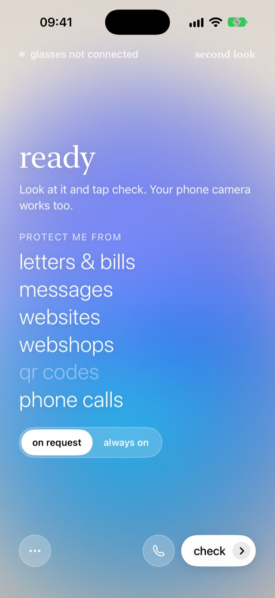
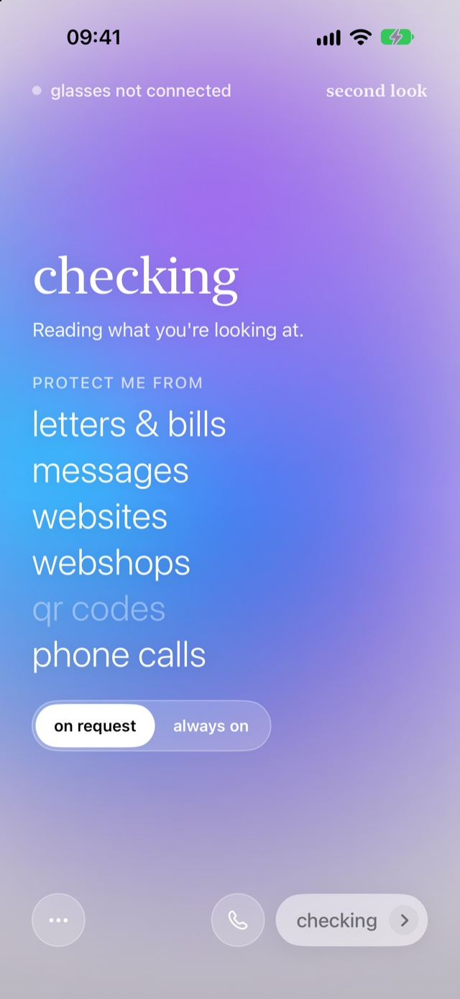
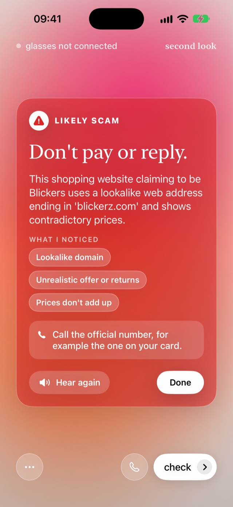
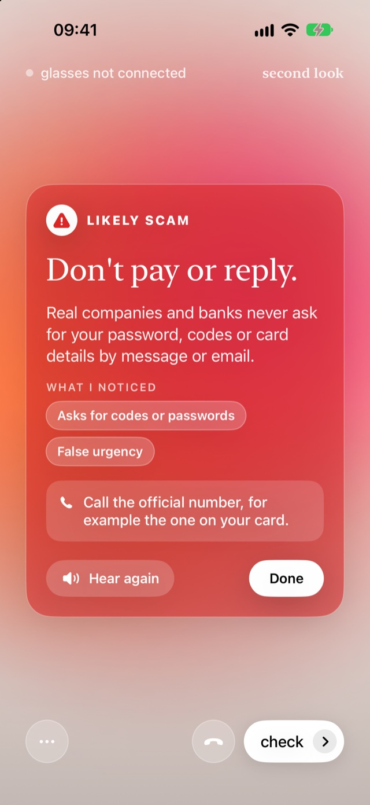
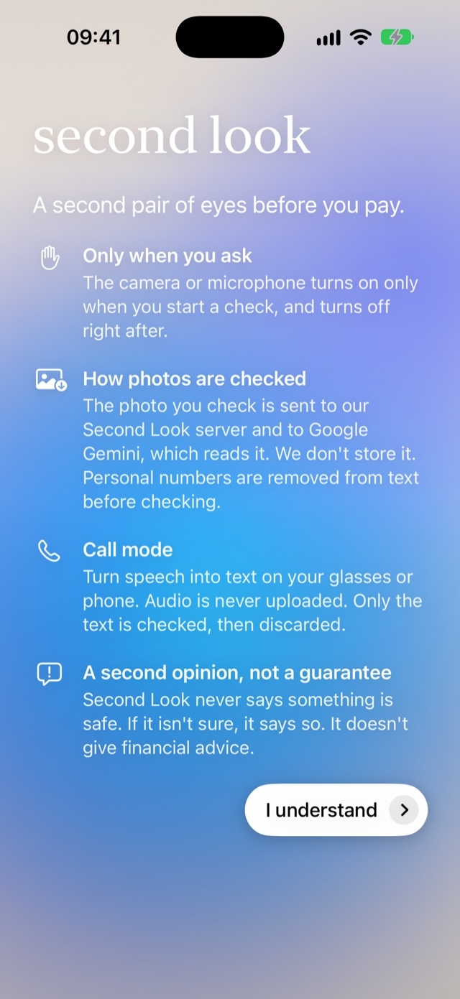
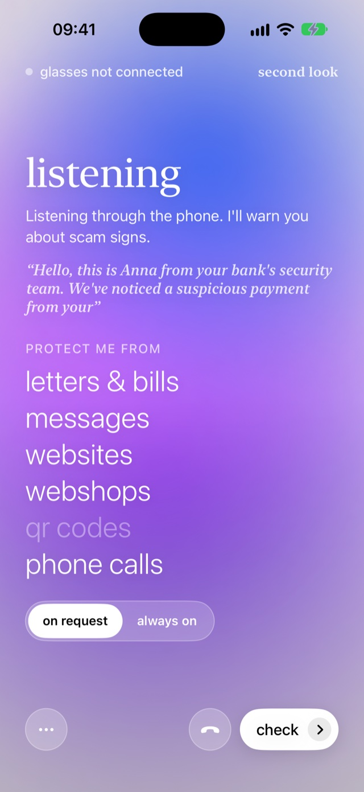
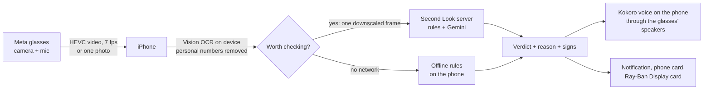

# Second Look for iOS

The iPhone app that turns Meta AI glasses into a scam checker. Look at a letter, a text, a webshop or listen to a call; Second Look tells you, out loud, whether it shows scam signs and why.

SwiftUI · iOS 17.2+ · [Meta Wearables Device Access Toolkit](https://github.com/facebook/meta-wearables-dat-ios) 1.0.1 · Apple Vision · on-device Kokoro voice

<p align="center">
  
  
  
  
</p>

## What it does

| You | Second Look |
|---|---|
| Look at something and tap **check** (or press the glasses' capture button) | Takes one photo through the glasses, reads it, answers in about 2 seconds |
| Turn on **always on** | Checks quietly every 15 seconds and only speaks when something looks wrong |
| Start **call check** during a call | Turns the call into text on the device and warns when the caller asks for a code, a transfer or a "safe account" |
| Choose what to guard | Letters & bills, messages, websites, webshops, QR codes, phone calls |

Every answer has the same shape: a verdict (**likely scam**, **be careful**, **no scam signs**, **not sure**), what to do, one plain reason, and the signs it noticed. It is spoken through the glasses, shown as a notification and a card on the phone, and sent as a card to Ray-Ban Display. It never says "safe": when unsure it says "not sure, don't pay yet".

<details>
<summary>All screens</summary>
<p>
  
  
  
  
  
  
</p>
</details>

## How a check works



1. **Capture.** `GlassesManager` holds one Device Access Toolkit session. The glasses stream compressed HEVC video at 7 frames a second; `HEVCDecoder` decodes every frame on the phone and keeps only the newest picture. Compressed video keeps the glasses' wireless link stable.
2. **Read on the phone.** `OfflineChecker` runs Apple Vision text recognition (Finnish and English) and counts text regions, so a full photo is only taken when there is something to read.
3. **Judge.** `APIClient` sends one downscaled frame to the server, which runs deterministic checks (look-alike addresses, prices that don't add up, wording rules) and asks Gemini to read the image. The phone holds no AI keys.
4. **Answer.** `Speaker` speaks with Kokoro-82M running on the phone's Neural Engine (via FluidAudio), falling back to the system voice until the model is ready. With the glasses connected for audio, iOS plays it through their open-ear speakers. `DisplayCards` sends a short card to Ray-Ban Display.

## Built for real conditions

| Situation | What the app does |
|---|---|
| Camera or microphone refused | Says so in plain words; you can still check with the phone camera or a photo |
| No network or server down | Falls back to on-device OCR and a subset of the rules (`OfflineChecker`) |
| Glasses hot, low on battery or disconnected | Tells you, so you can check with the phone camera instead |
| No speech on the glasses | Call check uses on-device Apple speech recognition (`PhoneListener`), preferring the glasses' microphone |
| Privacy | Nothing is stored. Card, IBAN, ID, phone and email numbers are removed before text leaves the phone. Audio is never uploaded. DAT analytics and crash reporting are off in `Info.plist` |

## Code map

| Area | Files |
|---|---|
| App entry, SDK setup | `SecondLook/App/SecondLookApp.swift` |
| Glasses: registration, session, video, photo, capture button, Display card | `Glasses/GlassesManager.swift`, `Glasses/HEVCDecoder.swift`, `Glasses/DisplayCards.swift` |
| Check flow, always on, call mode, fallbacks | `Check/CheckCoordinator.swift` |
| Server client (`/analyze-image`, `/analyze`) | `Check/APIClient.swift` |
| On-device OCR, offline rules, redaction | `Check/OfflineChecker.swift` |
| Phone camera live scan | `Check/LiveCamera.swift`, `Views/LiveScanView.swift` |
| Voice out (Kokoro), call listening | `Voice/Speaker.swift`, `Voice/PhoneListener.swift` |
| UI: home, alert card, consent, settings, aurora background | `Views/` |

## Run it

Requirements: Xcode 27 (built with 27.2), [XcodeGen](https://github.com/yonaskolb/XcodeGen), an iPhone with iOS 17.2+ for real glasses (the Simulator works for everything except the glasses).

```bash
cd ios
cp Config.example.xcconfig Config.xcconfig   # git-ignored: team ID, app token, Meta app ID
xcodegen generate                            # creates SecondLook.xcodeproj from project.yml
open SecondLook.xcodeproj
```

Fill `Config.xcconfig`: `DEVELOPMENT_TEAM`, and `META_APP_ID` + `CLIENT_TOKEN` from the Wearables Developer Center (not needed when the glasses are in Developer Mode). The app talks to `https://secondlook.pgf.lv` by default; to use your own server, run [`../api`](../api) and set its address in Settings.

Debug builds accept two launch arguments for demos without glasses:

| Argument | Effect |
|---|---|
| `--demo-check` | Checks the bundled fake-webshop photo a few seconds after launch |
| `--demo-call` | Feeds a scripted bank-impersonation call, word by word, into the real call check |

Keep `INFOPLIST_FILE` in `project.yml` and don't add an `info:` block: XcodeGen would regenerate `Info.plist` and drop the `MWDAT` keys.

## Status

- Ran on real Meta glasses on 14 Nov 2026: glasses video in, verdict and spoken warning out. Call check ran through the glasses microphone.
- Server answers in about 2 seconds (timed at 1.7, 2.0 and 1.7 s).
- The Ray-Ban Display card is built but does not show yet; today the answer is spoken and shown on the phone.
